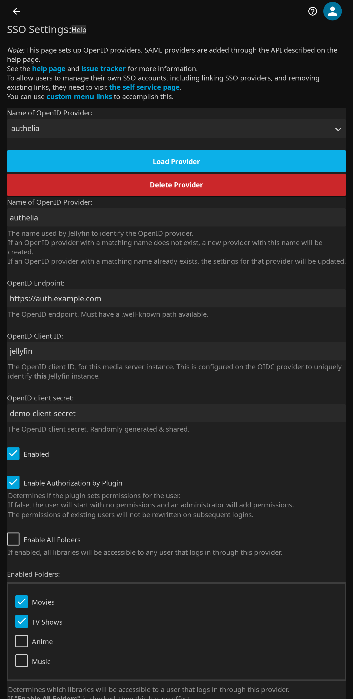
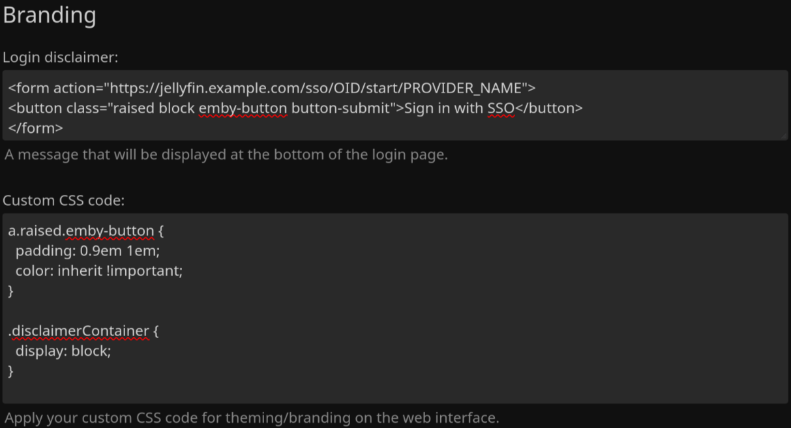

<p align="center">
  
</p>

# jellyfin-plugin-sso

<p align="center">
  
  <a href="https://github.com/voc0der/jellyfin-plugin-sso/releases/latest">
    
  </a>
  <a href="https://github.com/voc0der/jellyfin-plugin-sso/blob/main/manifest.json">
    
  </a>
  <a href="https://github.com/voc0der/jellyfin-plugin-sso/tree/main/tests">
    
  </a>
  <a href="https://github.com/voc0der/jellyfin-plugin-sso/actions/workflows/codeql.yml">
    
  </a>
  <a href="https://github.com/voc0der/jellyfin-plugin-sso/issues">
    
  </a>
  <a href="LICENSE">
    
  </a>
</p>

A Jellyfin plugin that lets people sign in to Jellyfin through an OpenID Connect or SAML identity provider, such as Authelia, authentik, Keycloak, Pocket ID or Kanidm. Accounts are created on first sign-in, and the provider's groups decide who may sign in, who is an administrator, and which libraries and Live TV each account can use.

It continues [9p4/jellyfin-plugin-sso](https://github.com/9p4/jellyfin-plugin-sso), archived in May 2026, for Jellyfin 12, as a plugin of its own. See [Moving from 9p4's plugin](#moving-from-9p4s-plugin).

<p align="center">
  
</p>
<p align="center">
  <em>Configuration page inside the Jellyfin dashboard</em>
</p>

## Features

- OpenID Connect sign-in, run against a real Authelia and Jellyfin 12 on every change
- Optional [automatic sign-in](#automatic-sign-in) sends browsers to a selected provider when they need to sign in
- SAML 2.0 sign-in, accepting only responses signed by the provider's certificate
- Accounts created on first sign-in, and found again by their provider identity even after a rename
- The provider's groups or roles decide who may sign in, who is an administrator, which libraries each account sees, and Live TV access and management
- People with an existing Jellyfin account link their provider identity themselves at `/SSOViews/linking`
- Accounts made by sign-in have no usable password: they sign in through the provider only. So does an existing account that would take an empty password, once its owner signs in
- Password sign-in can be [turned off](#turning-off-password-sign-in) for the whole server with `JELLYFIN_ENABLE_PASSWORD_LOGIN=false` in its environment, and back on by removing it
- Imports the providers and linked accounts of 9p4's plugin on first start
- Optional profile pictures from a provider claim
- A settings page for OpenID providers, and an API for both protocols

## Requirements

- Jellyfin 12
- An OpenID Connect or SAML 2.0 identity provider the Jellyfin server can reach over HTTPS
- Jellyfin Web to sign in. Apps that support [Quick Connect](https://jellyfin.org/docs/general/server/quick-connect) are signed in by approving them from Jellyfin Web.

## Installation

### Plugin Catalog

1. Open **Dashboard -> Plugins -> Repositories**
2. Add `https://raw.githubusercontent.com/voc0der/jellyfin-plugin-sso/main/manifest.json`
3. Install **SSO Authentication** from **Catalog**
4. Restart Jellyfin

> [!NOTE]
> Full repository of this author's plugins: [voc0der/jellyfin-plugins](https://github.com/voc0der/jellyfin-plugins).

### Manual Install

1. Download the latest ZIP from the [releases page](https://github.com/voc0der/jellyfin-plugin-sso/releases)
2. Extract it into your Jellyfin plugins directory
3. Restart Jellyfin

### Moving from 9p4's plugin

This plugin has its own ID, so Jellyfin does not update 9p4's plugin into it, and runs both if both are installed, which breaks sign-in: they answer the same addresses. Replace one with the other:

1. Uninstall **SSO Authentication** under **Dashboard -> Plugins**, remove 9p4's repository, and restart Jellyfin
2. Install this plugin as above, and restart again

Uninstalling leaves 9p4's settings in `plugins/configurations/SSO-Auth.xml`. On its first start, this plugin imports that file, so your providers and linked accounts carry over; the original is left as it is. Redirect URIs and sign-in links stay the same.

Releases from here need Jellyfin 12. On Jellyfin 10.11, stay on 9p4's 4.0.0.4.

> [!WARNING]
> Jellyfin 12 still loads 9p4's 4.0.0.4, and every account that plugin creates there can be signed in to with its username and an empty password. This plugin locks each such account to SSO the next time its owner signs in through it, and logs a warning naming it. An account nobody signs in to again stays open: if you ran 4.0.0.4 on Jellyfin 12, give those accounts a long random password under **Dashboard -> Users**. Jellyfin 12's API reports them as having a password, so the only way to find them is to try: a `POST /Users/AuthenticateByName` with `{"Username": "name", "Pw": ""}` that answers 200 is one.

## Setup

Provider-specific steps, for Authelia, authentik, Keycloak (OpenID and SAML), Pocket ID and Kanidm, are in [providers.md](providers.md).

> [!WARNING]
> Signing in with an SSO name that matches an existing Jellyfin username signs in as that account, and with **Enable Authorization by Plugin** on, rewrites its permissions. Keep another administrator account before linking the only one.

### OpenID Connect

Open **Dashboard -> Plugins -> SSO Authentication**, enter a provider name, its address, client ID and secret, and save. The name is part of every address the plugin uses, so the provider needs this redirect URI:

```text
https://jellyfin.example.com/sso/OID/redirect/PROVIDER_NAME
```

Sign-in starts at `https://jellyfin.example.com/sso/OID/start/PROVIDER_NAME`.

### SAML

SAML providers are added through the [API](#configuration-1). The provider posts its response to `https://jellyfin.example.com/sso/SAML/post/PROVIDER_NAME`, and sign-in starts at `https://jellyfin.example.com/sso/SAML/start/PROVIDER_NAME`. Responses have to be signed: Keycloak's **Sign Documents** on, with the client's certificate as `samlCertificate`.

### Behind a reverse proxy

The plugin builds its redirect URIs from the address a request came in on. Behind a proxy that terminates TLS, add the proxy under **Dashboard -> Networking -> Known proxies** so Jellyfin trusts its `X-Forwarded-*` headers, or set the provider's scheme override (`SchemeOverride: "https"`) and, for a non-standard port, `PortOverride`.

### A sign-in button on the login page

Under **Dashboard -> General -> Branding**, add this to **Login disclaimer**, with your domain and provider name:

```html
<form action="https://jellyfin.example.com/sso/OID/start/PROVIDER_NAME">
  <button class="raised block emby-button button-submit">
    Sign in with SSO
  </button>
</form>
```

and this to **Custom CSS code**:

```css
a.raised.emby-button {
  padding: 0.9em 1em;
  color: inherit !important;
}

.disclaimerContainer {
  display: block;
}
```



### Automatic sign-in

Under **Dashboard -> Plugins -> SSO Authentication**, choose an enabled OpenID or SAML provider
in **Automatic Sign-In**, check **Enable Automatic Sign-In**, and save that section. It is off
by default; changes take effect on the next load of Jellyfin Web, without a server restart.

A browser that needs to sign in goes straight to the selected provider. If it already has a
session with that provider, it returns signed in without a click. Existing Jellyfin sessions
keep working, and a link to a page inside Jellyfin Web is restored after sign-in.

Signing out, or opening `/web/#/login` directly, keeps the normal login page in that browser
until someone signs in again. A rejected automatic sign-in or failed session exchange returns
to that page without retrying in a loop. If the provider itself is unavailable or leaves you on
its own error page, open `/web/#/login` to return. Include your server's base path if it has one.

While automatic sign-in is enabled, the plugin also adds a **Sign in with SSO** button to the
login page for the selected provider. It remains available after signing out, after a failed
sign-in, and in apps that embed Jellyfin Web. On Android, the button preserves the app's device
ID when signing in. No separate script or branding button is needed for this provider.

Automatic redirects skip clients with Jellyfin's native shell and Android WebViews; these
clients can use the button instead. The script does not run inside frames.
API authentication and Quick Connect remain available.
This setting does not turn off password sign-in or sign you out of the provider. Use a
[custom sign-in button](#a-sign-in-button-on-the-login-page) if automatic sign-in is disabled or
you want to offer other providers.

The plugin adds its script as Jellyfin serves the web page, without changing files on disk.
A separately hosted copy of Jellyfin Web does not receive it. If the selected provider is
removed or disabled, the normal login page is shown, with a warning in the plugin settings and
server log.

### Turning off password sign-in

To have everyone sign in through the provider, set `JELLYFIN_ENABLE_PASSWORD_LOGIN=false` in Jellyfin's environment and restart it. With Docker Compose:

```yaml
services:
  jellyfin:
    environment:
      JELLYFIN_ENABLE_PASSWORD_LOGIN: "false"
```

Jellyfin then answers every username and password, right or wrong, with 403 Forbidden, without checking it. Jellyfin Web shows that as "You are not authorized to access the server at this time". Nothing else changes:

- Sign-in through the provider works as before, and so does [Quick Connect](https://jellyfin.org/docs/general/server/quick-connect), so apps can still be signed in by approving them from a browser.
- Devices already signed in stay signed in, and API keys keep working. **Dashboard -> Devices** signs devices out, to have their owners sign in again.
- Accounts keep their passwords, unused while passwords are off. Passwords other plugins check, such as LDAP's, are refused too.

Before turning passwords off, make sure an administrator can sign in through the provider (`adminRoles`), or nobody will reach the dashboard. To turn passwords back on, remove the variable or set it to `true`, and restart Jellyfin. That is also the way back in when the provider is down: the switch is in the server's environment, so changing it needs nobody to sign in. Unset, or set to anything but `false`, passwords work as they always have.

At startup, the log says when passwords are off, and warns of a value that is neither `true` nor `false`. Each refused password sign-in is logged with the address it came from.

Jellyfin Web still shows its password form. To leave only Quick Connect and the [sign-in button](#a-sign-in-button-on-the-login-page), add this to **Custom CSS code** too:

```css
#loginPage .manualLoginForm,
#loginPage .visualLoginForm,
#loginPage .btnManual,
#loginPage .btnForgotPassword {
  display: none !important;
}
```

### Linking existing accounts

Someone signed in to an existing Jellyfin account can attach their provider identity to it at `https://jellyfin.example.com/SSOViews/linking`, and remove it again there. After that, signing in through the provider opens that account. [Custom menu links](https://jellyfin.org/docs/general/clients/web-config.html#custom-menu-links) can put the page in Jellyfin Web's menu.

## API

Every path starts at `/sso/`. Endpoints that read or change settings need an administrator's API key, sent as a header. Jellyfin 12 no longer accepts the `api_key` query parameter unless legacy authorization is switched back on.

```bash
curl -H 'Authorization: MediaBrowser Token="API_KEY"' "https://jellyfin.example.com/sso/OID/Get"
```

### OpenID

#### Flow

- GET `OID/start/PROVIDER_NAME`: begins sign-in with the provider, which sends the browser back to:
- GET `OID/redirect/PROVIDER_NAME`: the callback. Returns a page that completes sign-in.
- POST `OID/Auth/PROVIDER_NAME`: called by that page to receive the Jellyfin session. JSON with `deviceId`, `deviceName`, `appName`, `appVersion` and `data`, the OpenID state.

`OID/p/` and `OID/r/` are older names for `start` and `redirect`.

#### Configuration

- POST `OID/Add/PROVIDER_NAME`: adds a provider, or replaces the one with that name. For example:

  ```bash
  curl -X POST -H 'Authorization: MediaBrowser Token="API_KEY"' -H "Content-Type: application/json" \
    -d '{"oidEndpoint": "https://keycloak.example.com/realms/test", "oidClientId": "jellyfin-oid", "oidSecret": "short secret here", "enabled": true, "enableAuthorization": true, "enableAllFolders": false, "enabledFolders": [], "adminRoles": ["jellyfin-admin"], "roles": ["allowed-to-use-jellyfin"], "enableFolderRoles": true, "folderRoleMapping": [{"role": "allowed-to-watch-movies", "folders": ["cc7df17e2f3509a4b5fc1d1ff0a6c4d0", "f137a2dd21bbc1b99aa5c0f6bf02a805"]}], "roleClaim": "realm_access.roles", "oidScopes": []}' \
    "https://jellyfin.example.com/sso/OID/Add/PROVIDER_NAME"
  ```

  The keys:
  - `oidEndpoint`: string. The provider's address; `/.well-known/openid-configuration` must be under it.
  - `oidClientId`, `oidSecret`: strings. The client ID and secret.
  - `enabled`: boolean. Whether the provider can be used.
  - `enableAuthorization`: boolean. Whether the plugin sets each account's permissions at sign-in. Off, accounts keep Jellyfin's defaults and whatever an administrator gives them.
  - `enableAllFolders`: boolean. Whether accounts from this provider can see every library.
  - `enabledFolders`: array of strings. The libraries they can see otherwise, by ID (`GET /Library/MediaFolders` lists them).
  - `roles`: array of strings. Anyone with one of these roles may sign in. Empty, anyone the provider signs in may.
  - `adminRoles`: array of strings. Anyone with one of these roles is an administrator.
  - `enableFolderRoles`: boolean. Whether `folderRoleMapping` decides library access.
  - `folderRoleMapping`: array of `{"role": string, "folders": [string]}`. The libraries each role can see.
  - `enableLiveTvRoles`: boolean. Whether `liveTvRoles` and `liveTvManagementRoles` decide Live TV access.
  - `liveTvRoles`, `liveTvManagementRoles`: arrays of strings. Roles that may watch, and manage, Live TV.
  - `enableLiveTv`, `enableLiveTvManagement`: booleans. Live TV access, and management, for everyone from this provider.
  - `roleClaim`: string. The claim the roles are in, for example `groups`, or `realm_access.roles` for Keycloak. Each `.` steps into the claim's JSON; write `\.` for a literal dot. The claim must hold a list of strings.
  - `oidScopes`: array of strings. Scopes to request besides `openid profile`. Some providers send groups only for a `groups` scope.
  - `defaultUsernameClaim`: string. The claim usernames come from; `preferred_username` when unset.
  - `avatarUrlFormat`: string. An address for the account's picture, with `@{claim}` replaced by that claim's value. The server fetches it at each sign-in; one that cannot be fetched, or is not an image, leaves the old picture. Unset, pictures are left alone.
  - `defaultProvider`: string. An authentication provider to hand the account to after sign-in, so it can also sign in another way, such as `Jellyfin.Server.Implementations.Users.DefaultAuthenticationProvider` for a password.
  - `disableHttps`: boolean. Allows a provider without HTTPS. Avoid it: the plugin trusts the provider's tokens because they arrive over TLS.
  - `disablePushedAuthorization`: boolean. Required for Authelia; see [providers.md](providers.md#authelia).
  - `doNotValidateEndpoints`: boolean. Allows provider endpoints on other hosts, which Google needs.
  - `doNotValidateIssuerName`: boolean. Skips checking the issuer's name.
  - `doNotLoadProfile`: boolean. Skips the userinfo endpoint, so claims come from the ID token alone.
  - `schemeOverride`: string. `http` or `https`, for the addresses the plugin builds.
  - `portOverride`: number. The port for the addresses the plugin builds.
- GET `OID/Del/PROVIDER_NAME`: removes a provider.
- GET `OID/Get`: lists the providers and their settings.
- GET `OID/GetNames`: lists the providers' names. Open to anyone, for sign-in buttons.
- GET `OID/States`: lists sign-ins in progress.

### SAML

#### Flow

- GET `SAML/start/PROVIDER_NAME`: begins sign-in with the provider, which posts its response to:
- POST `SAML/post/PROVIDER_NAME`: returns a page that completes sign-in.
- POST `SAML/Auth/PROVIDER_NAME`: called by that page to receive the Jellyfin session. JSON with `deviceId`, `deviceName`, `appName`, `appVersion` and `data`, the signed response.

`SAML/p/` is an older name for `start` and `post`.

#### Configuration

- POST `SAML/Add/PROVIDER_NAME`: adds a provider, or replaces the one with that name. For example:

  ```bash
  curl -X POST -H 'Authorization: MediaBrowser Token="API_KEY"' -H "Content-Type: application/json" \
    -d '{"samlEndpoint": "https://keycloak.example.com/realms/test/protocol/saml", "samlClientId": "jellyfin-saml", "samlCertificate": "Very long base64 encoded string here", "enabled": true, "enableAuthorization": true, "enableAllFolders": false, "enabledFolders": [], "adminRoles": ["jellyfin-admin"], "roles": ["allowed-to-use-jellyfin"], "enableFolderRoles": true, "folderRoleMapping": [{"role": "allowed-to-watch-movies", "folders": ["cc7df17e2f3509a4b5fc1d1ff0a6c4d0", "f137a2dd21bbc1b99aa5c0f6bf02a805"]}]}' \
    "https://jellyfin.example.com/sso/SAML/Add/PROVIDER_NAME"
  ```

  The keys are the OpenID ones above, without the OpenID-only ones (`roleClaim` to `doNotLoadProfile`), plus:
  - `samlEndpoint`: string. The provider's SAML address.
  - `samlClientId`: string. The client ID.
  - `samlCertificate`: string. The provider's signing certificate, Base64. Responses it did not sign are refused.

  Roles come from the response's `Role` attribute.
- GET `SAML/Del/PROVIDER_NAME`: removes a provider.
- GET `SAML/Get`: lists the providers and their settings.
- GET `SAML/GetNames`: lists the providers' names. Open to anyone, for sign-in buttons.

### Accounts

- POST `Unregister/USERNAME`: hands an account to another authentication provider, posted as a JSON string. To let it sign in with a password again:

  ```bash
  curl -X POST -H 'Authorization: MediaBrowser Token="API_KEY"' -H "Content-Type: application/json" \
    -d '"Jellyfin.Server.Implementations.Users.DefaultAuthenticationProvider"' \
    "https://jellyfin.example.com/sso/Unregister/USERNAME"
  ```

## Limitations

- Sign-in works in Jellyfin Web, and in apps through Quick Connect.
- Signing out of Jellyfin does not sign out of the provider.
- SAML providers are set up through the API only.

## Build Manually

See [CONTRIBUTING.md](CONTRIBUTING.md) for development information.

## Credits

Written by [9p4](https://github.com/9p4) and its contributors, who maintained it from 2022 until May 2026, starting from the [Jellyfin LDAP plugin](https://github.com/jellyfin/jellyfin-plugin-ldapauth). SAML uses a patched copy of [AspNetSaml](https://github.com/jitbit/AspNetSaml), and OpenID the [Duende IdentityModel OIDC Client](https://github.com/DuendeSoftware/foss).
